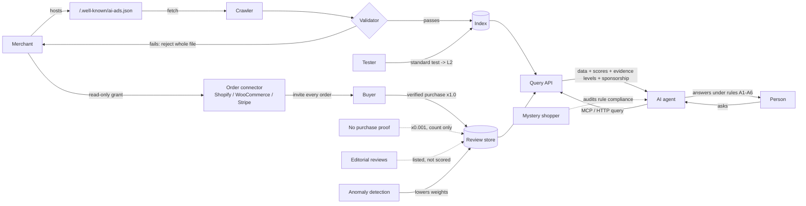
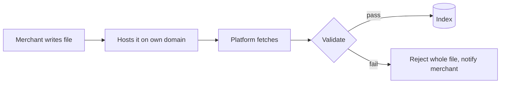
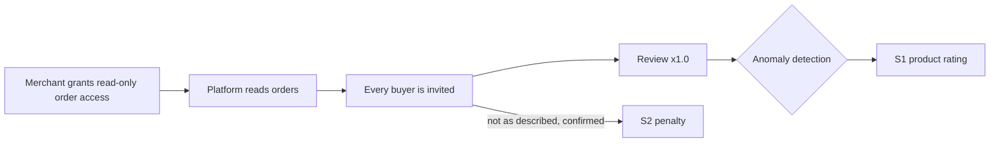
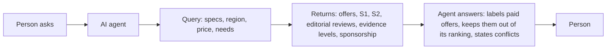
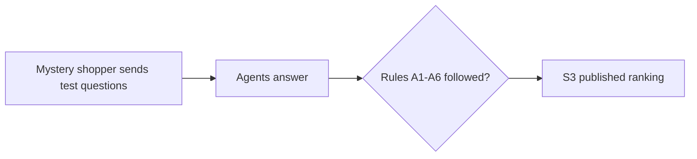
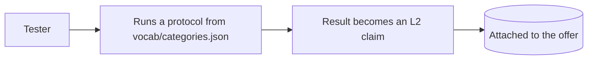

# Architecture

How data moves through an AIAD platform: merchants publish verifiable product data, the platform validates it and attaches weighted reviews, AI agents query it and must present it honestly.

The same architecture in machine-readable form: [`architecture/architecture.ai.json`](architecture/architecture.ai.json).

## Overview

## Three scores

| Score | Measures | Lowered when | Charged to |
|---|---|---|---|
| **S1** product rating | Verified-purchase reviews only | Anomaly detection flags reviews | — |
| **S2** merchant data accuracy | Does the listing match reality | A verified buyer reports "not as described" and it is confirmed | Merchant account |
| **S3** agent rule compliance | Does the agent follow A1–A6 | Mystery-shopper test fails | Account that owns the agent |

## Identity

Every actor is tied to an accountable human account. One rule for everyone: penalties land on the account owner.

| Actor | Bound to | Can | Penalties go to |
|---|---|---|---|
| Buyer | Google account | Review, report "not as described" | Self |
| Merchant | Google account + domain ownership (DNS TXT or token in `ai-ads.json`) | Publish offers, connect order source | Account owner |
| AI agent | API key registered under a Google account | Query, relay | Account owner |

Out of scope for this draft: many Google accounts created from many phone numbers, merchants paying for fake orders (brushing), returns.

## Flow 1 — Publish

Validation = JSON Schema + category vocabulary + date checks + domain binding + a scan for text aimed at AI. Run it yourself with [`tools/aiad_validate.py`](tools/aiad_validate.py).

## Flow 2 — Reviews

The platform, not the merchant, sends review invitations. If merchants issued purchase proofs, they could invite only happy customers: every review would be genuine and the score would still be inflated.

## Flow 3 — Answer

## Flow 4 — Audit

## Flow 5 — Standard tests

Same method for every product in a category, so results can be compared directly. The idea comes from car review platforms that test every car under identical conditions.
